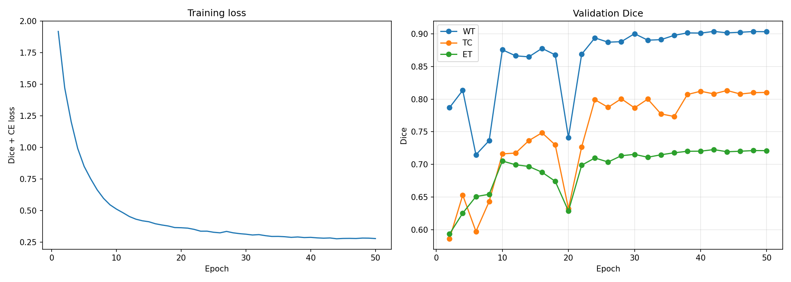

# Brain Tumour MRI Segmentation (3D)

## About
A step-by-step learning project to build a 3D brain tumour segmentation model
using multi-modal MRI scans. The goal is to train a model that labels every
voxel of a brain scan as healthy tissue or a tumour sub-region, and to build a
simple Python viewer to visualise the predicted tumour regions.

## Dataset
**BraTS 2020** (Brain Tumor Segmentation Challenge), from the Kaggle dataset
*"BraTS2020 Dataset (Training + Validation)"* (CC0: Public Domain).

- 369 training patients
- Each patient has 4 MRI scans (NIfTI `.nii`, size 240 × 240 × 155):
  - `flair` – highlights swelling (oedema)
  - `t1` – normal anatomy
  - `t1ce` – T1 with contrast, highlights the active tumour
  - `t2` – fluid appears bright
- 1 segmentation mask (`seg`) with labels:
  - `0` – background / healthy tissue
  - `1` – necrotic tumour core
  - `2` – peritumoural oedema
  - `4` – enhancing tumour
  - (label `3` is not used in BraTS 2020)

> The data is not included in this repository because of its size.
> Download it from Kaggle and place it in a `data/` folder.

## Setup
```bash
python -m venv venv
venv\Scripts\activate
pip install numpy nibabel matplotlib
python explore.py
```

## Progress
- [x] Step 1: Dataset – found and understood the BraTS 2020 data
- [x] Step 2: Python setup – virtual environment and libraries
- [x] Step 3: Exploring scans – compared 4 MRI modalities, overlaid tumour masks, measured class imbalance (tumour = 2.37% of voxels)
- [x] Step 4A: Colab setup (Kaggle GPU unavailable), data check, fixed mislabeled seg file (patient 355)
- [x] Step 4B: Preprocessing – z-score normalisation, label 4→3, crop to 160×192×144 (reduced tumour crop loss from 4.1% avg / 61% max to <0.03%)
- [x] Step 4C: Model – lightweight 3D U-Net (base 16 channels, 5.6M parameters, ~22.6 MB)
- [x] Step 4D (setup): 70/15/15 patient split (seed 42), tumour-biased 128³ patch sampling, Dice + Cross-Entropy loss, mixed-precision training test (1.38 GB peak GPU memory on Tesla T4)
- [x] Step 4D: Full training and validation
- [x] Step 4E: Testing (Dice for WT / TC / ET)
- [ ] Step 5: Viewer

## Results (test set, n = 56)
| Region | Mean ± SD | Median |
|---|---|---|
| Whole Tumour (WT) | 0.880 ± 0.098 | 0.903 |
| Tumour Core (TC) | 0.786 ± 0.221 | 0.859 |
| Enhancing Tumour (ET) | 0.713 ± 0.254 | 0.806 |

Lightweight 3D U-Net (5.6M parameters), trained 50 epochs (~76 min) on a free Colab Tesla T4.



**Notes:** ET post-processing (threshold 500 voxels, tuned on validation) improved
validation ET (0.721 → 0.770) but not test ET (0.713 → 0.711). Error analysis showed
ET false positives were large, confident regions rather than small noise.

## Tools
Python 3.12 · NumPy · NiBabel · Matplotlib · PyTorch · Google Colab (Tesla T4 GPU)